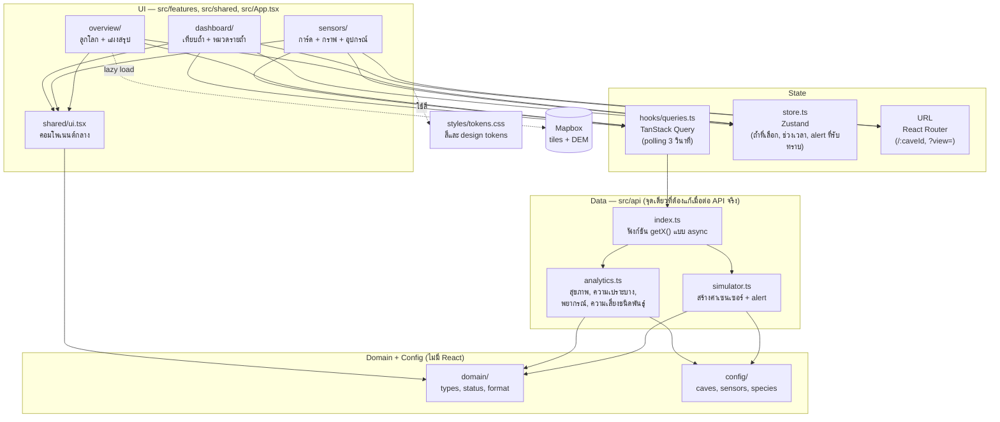
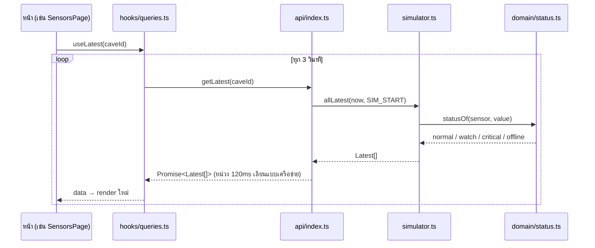

# natural-cave-thailand — Smart Cave Platform (Prototype)

Prototype ของ **National Smart Cave Platform** ศูนย์เฝ้าระวังระบบนิเวศถ้ำของไทย ติดตามเซนเซอร์ 5 ตัวแปรใน 3 ถ้ำ แล้วสรุปเป็นข้อมูลเพื่อการตัดสินใจเชิงอนุรักษ์
ข้อมูลทั้งหมดเป็น **mock** ที่จำลองขึ้นในเบราว์เซอร์ ไม่มี backend

| หน้า | เส้นทาง | เนื้อหา |
|---|---|---|
| ภาพรวม | `/` | ลูกโลก 3D (Mapbox) ปักหมุด 3 ถ้ำ, ภูมิประเทศ 3D เฉพาะไทย, เข็มทิศ, KPI ประเทศ, feed alert, แผงซ้าย/ขวาพับได้ |
| เซนเซอร์ | `/sensors/:caveId` | การ์ด 5 เซนเซอร์ (ค่าสด + sparkline), กราฟใหญ่พร้อมเส้นเกณฑ์ + ดาวน์โหลด CSV, ตารางสถานะอุปกรณ์ |
| Dashboard | `/dashboard/all` | เทียบ 3 ถ้ำ: KPI, กราฟเทียบ, อันดับความเปราะบาง, เหตุการณ์ผิดปกติรายวัน |
| | `/dashboard/:caveId?view=` | รายถ้ำ แบ่งหมวด: `all` รวมทุกหมวด · (ไม่ระบุ) สถิติ · `bio` ความหลากหลายทางชีวภาพ · `info` ข้อมูลถ้ำ (ทะเบียน) |
| ทะเบียน · ถ้ำ | `/registry`, `/registry/new`, `/registry/:caveId/edit` | ตารางถ้ำทั้งหมด ค้นหาและกรอง, เพิ่ม แก้ไข ลบ, ส่งออก JSON / CSV, ฟอร์มเติมภาค จังหวัด อำเภอจากพิกัด, อัปโหลดรูปแผนที่ถ้ำ |
| ทะเบียน · ชนิดพันธุ์ | `/registry/species`, `/registry/species/:id`, `…/new`, `…/:id/edit` | ตารางชนิดพันธุ์, โปรไฟล์ (อนุกรมวิธาน, IUCN, สัตว์ถ้ำแท้, การแพร่กระจาย, กราฟประชากร, ตัวอย่างอ้างอิง, DNA), ฟอร์มเพิ่ม/แก้ไข |
| บันทึกการพบ | `/registry/occurrence/new?cave=&species=`, `/registry/occurrence/:id/edit` | การพบชนิดพันธุ์ในแต่ละถ้ำ: แหล่งที่อยู่, ความชุกชุม, ผลนับประชากร, ตัวอย่างอ้างอิง |

## วิธีรัน

```bash
npm install
cp .env.example .env     # ใส่ VITE_MAPBOX_TOKEN=pk.... (สร้างได้ที่ account.mapbox.com)
npm run dev              # http://localhost:5173
npm run build            # tsc --noEmit + vite build
npm test                 # vitest
npm run check:colors     # ตรวจว่าไม่มีสีนอกพาเลตต์
```

ถ้าไม่ใส่ token หน้า "ภาพรวม" จะแสดงการ์ดถ้ำและวิธีตั้งค่าแทนแผนที่ ส่วนอื่นของแอปใช้งานได้ครบ

---

## สถาปัตยกรรม

แอปแบ่งเป็นชั้น (layer) ที่พึ่งพากันทางเดียวจากบนลงล่าง ชั้นบนรู้จักชั้นล่าง แต่ชั้นล่างไม่รู้จักชั้นบน



### ข้อมูลไหลอย่างไร



### หลักการออกแบบ

- **ชั้นข้อมูลสลับได้** UI เรียกข้อมูลผ่าน `hooks/queries.ts` → `api/index.ts` เท่านั้น ถ้าจะต่อ API จริง แก้เฉพาะไฟล์ใน `src/api/` โดยคงลายเซ็นฟังก์ชันเดิม UI ไม่ต้องแก้
- **สถานะตัดสินที่เดียว** เกณฑ์ ปกติ / เฝ้าระวัง / วิกฤต / ออฟไลน์ อยู่ใน `domain/status.ts` + `config/sensors.ts` ห้ามหน้าไหนเขียนเกณฑ์เอง
- **ถ้ำที่เลือกตรงกันทุกหน้า** เก็บทั้งใน URL (แชร์ลิงก์ได้) และใน store (จำไว้เมื่อสลับหน้า) ผ่าน `useCaveRoute()`
- **สีอยู่ที่เดียว** ทุกสีมาจากตัวแปรใน `styles/tokens.css` สคริปต์ `check:colors` ตรวจว่าไม่มี hex ที่อื่น
- **Mapbox โหลดแบบ lazy** แยกเป็น chunk ของตัวเอง (~1.9 MB) หน้าเซนเซอร์และ Dashboard จึงเปิดได้เร็ว

---

## แต่ละส่วนทำอะไร

### `src/` ระดับบนสุด

| ไฟล์ | หน้าที่ |
|---|---|
| `main.tsx` | จุดเริ่มแอป: สร้าง `QueryClient`, ครอบด้วย `BrowserRouter`, render `<App />` |
| `App.tsx` | โครงหน้า: แถบเมนูบน (โลโก้, แท็บ 3 หน้า, ปุ่ม Alert พร้อมรายการที่ยังไม่รับทราบ) และ routes; หน้าภาพรวมโหลดแบบ `React.lazy` |
| `store.ts` | Zustand store: ถ้ำที่เลือกล่าสุด, ช่วงเวลากราฟ, alert ที่รับทราบแล้ว (ช่วงเวลาและ alert ที่รับทราบบันทึกลง localStorage ถ้าเบราว์เซอร์อนุญาต) |
| `styles.css` | สไตล์ทั้งแอป แบ่งตามส่วน (shell, controls, status, overview, sensors, dashboard, responsive) |
| `styles/tokens.css` | **แหล่งเดียวของสี** + ฟอนต์, ขนาดตัวอักษร, spacing, radius, motion |

### `src/domain/` — กฎทางธุรกิจ (TypeScript ล้วน ไม่มี React)

| ไฟล์ | หน้าที่ |
|---|---|
| `types.ts` | ชนิดข้อมูลหลัก: `Cave`, `SensorDef`, `Reading`, `Latest`, `CaveAlert`, `Device`, `Species` ฯลฯ |
| `status.ts` | `statusOf()` แปลงค่าเซนเซอร์เป็นสถานะ, `worstStatus()` หาสถานะรุนแรงสุดของถ้ำ, ป้ายชื่อสถานะ |
| `format.ts` | จัดรูปแบบตัวเลข, วันเวลา, "x นาทีที่แล้ว", ระยะเวลา (ภาษาไทย, เวลา UTC+7) |

### `src/config/` — ข้อมูลตั้งต้น (แก้ค่าได้โดยไม่ต้องแตะโค้ดส่วนอื่น)

| ไฟล์ | หน้าที่ |
|---|---|
| `caves.ts` | 3 ถ้ำ: พิกัด, จังหวัด, ความสูง, ค่าพื้นฐานของเซนเซอร์, ค่าความเปราะบาง, ข้อความภูมิศาสตร์/ธรณีวิทยา/อุทกวิทยา; `THAILAND_VIEW` มุมกล้องเริ่มต้น |
| `sensors.ts` | 5 ตัวแปร (อุณหภูมิ, ความชื้น, CO₂, O₂, ระดับน้ำ): หน่วย, ทศนิยม, ช่วงปกติ, ช่วงเฝ้าระวัง, ช่วงแกนกราฟ |
| `species.ts` | ชนิดพันธุ์ (ชื่อสมมติ) และการพบในแต่ละถ้ำ พร้อมความอ่อนไหวต่อแต่ละตัวแปร |

### `src/api/` — ชั้นข้อมูล

| ไฟล์ | หน้าที่ |
|---|---|
| `index.ts` | **ประตูเดียวของข้อมูล** ฟังก์ชัน `getCaves`, `getLatest`, `getSeries`, `getDevices`, `getAlerts`, `getSpecies`, `getAnalytics`, `getDailyAnomalies`, `getForecast` คืน Promise เหมือนเรียก API จริง; แคช alert ไว้ 1 นาที |
| `simulator.ts` | สร้างค่าเซนเซอร์แบบ deterministic จาก (ถ้ำ, เซนเซอร์, เวลา, เวลาเริ่มแอป): ค่าพื้นฐาน + วงจรรายวัน + noise ต่อเนื่อง + เหตุการณ์ย้อนหลัง + เหตุการณ์สคริปต์; สร้างอนุกรมเวลา, ค่าล่าสุด, สถานะอุปกรณ์, และสแกน alert ย้อนหลัง 7 วัน |
| `analytics.ts` | คำนวณผลเชิงตัดสินใจ: ดัชนีสุขภาพ 0–100, ดัชนี 7 มิติ 0–1 (`caveIndices`), ดัชนีความเปราะบาง (exposure / sensitivity / adaptive capacity), Climate Refugia, พยากรณ์ 2026–2060 ตาม 3 scenario, ความเสี่ยงชนิดพันธุ์, จำนวนเหตุการณ์รายวัน |

### `src/hooks/queries.ts` — ดึงข้อมูลเข้า React

ห่อฟังก์ชันใน `api/` ด้วย TanStack Query: ค่าสด polling ทุก 3 วินาที (กราฟช่วงยาว 30 วินาที), ข้อมูลคงที่ (ถ้ำ, ชนิดพันธุ์, พยากรณ์) โหลดครั้งเดียว, `keepPreviousData` ไม่ให้หน้ากระพริบตอนรีเฟรช
`useOpenAlerts()` รวม alert ที่ยังเกิดอยู่และยังไม่รับทราบ ใช้กับปุ่ม Alert บนแถบเมนู

### `src/shared/ui.tsx` — คอมโพเนนต์กลาง

| คอมโพเนนต์ | ใช้ทำอะไร |
|---|---|
| `StatusGlyph`, `StatusBadge`, `StatusDot` | แสดงสถานะด้วยรูปทรง ● ○ ▲ ⊘ (badge วิกฤตแสดงเป็นไอคอนเตือนได้ด้วย `criticalIcon`) |
| `SensorIcon` | ไอคอนประจำตัวแปร (Lucide ผ่าน `react-icons`) |
| `Panel`, `Kpi`, `Loading` | กล่องเนื้อหา, กล่องตัวเลขสรุป, สถานะกำลังโหลด |
| `CaveSwitcher`, `RangePicker` | แถบเลือกถ้ำ, แถบเลือกช่วงเวลา (1 ชม. / 24 ชม. / 7 วัน / 30 วัน) |
| `RangeBar`, `Sparkline`, `ValueText` | แถบตำแหน่งค่าเทียบช่วงปกติ, กราฟเส้นเล็ก, ตัวเลข + หน่วย |
| `SeriesMarker`, `LegendSwatch`, `C`, `SERIES_DASH` | แยก series ในกราฟด้วยรูปแบบเส้นและเครื่องหมาย แทนการใช้หลายสี |
| `useCaveRoute()` | sync ถ้ำที่เลือกระหว่าง URL ↔ store และคง `?view=` เมื่อสลับถ้ำ |
| `downloadCsv()` | สร้างไฟล์ CSV (UTF-8 BOM เปิดใน Excel ภาษาไทยได้) |

### `src/features/` — หน้าจอ

| ไฟล์ | หน้าที่ |
|---|---|
| `overview/OverviewPage.tsx` | หน้าภาพรวม: KPI ประเทศ, รายชื่อถ้ำ, รายละเอียดถ้ำที่เลือก, feed alert; แผงซ้าย/ขวาพับได้ (`SideToggle`); มือถือเป็น bottom sheet; ไม่มี token → `NoMapFallback` |
| `overview/GlobeMap.tsx` | ลูกโลก Mapbox (style `standard`, projection globe): intro บินเข้าไทย, หมุดหยดน้ำตามสถานะ + hovercard, คลิกแล้วบินเข้าถ้ำ (ซูม 13.5 เอียง 65°), terrain 3D + hillshade เฉพาะกรอบไทยและเปิดเมื่อซูม ≥ 6 (`addTerrain`), เข็มทิศลอยมุมซ้ายล่าง (`Compass`) |
| `sensors/SensorsPage.tsx` | หน้าเซนเซอร์: การ์ด 5 ใบ (ไอคอน, ค่าสด, `RangeBar`, sparkline, แบตเตอรี่), กราฟใหญ่ (`SensorChart`) พร้อมแถบช่วงปกติ เส้นเกณฑ์ และจุดผิดปกติ + ดาวน์โหลด CSV, ตารางอุปกรณ์ |
| `dashboard/DashboardPage.tsx` | โครงหน้า Dashboard: แถบเลือกถ้ำที่ขยายแถวหมวดหมู่ลงมาเมื่อเลือกถ้ำ; เก็บหมวดใน `?view=` |
| `dashboard/AllView.tsx` | มุมมองรวม 3 ถ้ำ: KPI, spider chart 7 มิติซ้อน 3 ถ้ำ + ตารางค่าดัชนี, กราฟเทียบตัวแปร, ตารางอันดับความเปราะบาง, กราฟแท่งเหตุการณ์ผิดปกติ 7 วัน |
| `dashboard/CaveView.tsx` | มุมมองรายถ้ำ แบ่ง 4 แท็บ (`CAVE_TABS`): `StatsView` (CHI + spider chart 7 มิติ, พยากรณ์, เรดาร์, ไทม์ไลน์ alert + ปุ่มรับทราบ), `BioView` (สรุปชนิดพันธุ์, ความเสี่ยง, ตาราง), `GeoView` (ตัวเลขสำคัญ + การ์ดข้อมูลพื้นที่), และหน้ารวมทุกหมวด |
| `dashboard/IndexRadar.tsx` | Spider chart ดัชนี 7 มิติ (`IndexRadar`, ซ้อนหลายถ้ำได้), `IndexTable`, `CaveLegend`, สีประจำถ้ำ `CAVE_COLOR` |
| `dashboard/parts.tsx` | ชิ้นส่วนเฉพาะ Dashboard: `RefugiaTag`, `RiskPips` |

### อื่น ๆ

| ไฟล์ | หน้าที่ |
|---|---|
| `src/**/*.test.ts` | ทดสอบ `status.ts` (เกณฑ์สถานะ) และ `simulator.ts` (deterministic, ความยาวอนุกรม, เหตุการณ์สคริปต์ตอนเปิดแอป) |
| `scripts/check-colors.mjs` | ค้นทุกไฟล์ใน `src/` + `index.html` ถ้าเจอ hex/rgb/hsl นอก `tokens.css` หรือสีที่ไม่อยู่ในพาเลตต์ จะ fail |
| `public/cave-logo.png` | โลโก้บนแถบเมนูและ favicon |
| `.env.example` | ตัวอย่างตัวแปร `VITE_MAPBOX_TOKEN` |

---

## สีและการแสดงสถานะ

| สี | ใช้กับ |
|---|---|
| `#FFFFFF` | พื้นหลัง (`--c-bg`) |
| `#092328` | ตัวอักษร (`--c-text`) |
| `#2A835F` | สีเน้น (`--c-accent`): ปุ่ม, แท็บ active, สถานะ, กราฟ, หมุด, เข็มทิศ |
| `#2A835F` ผสมขาว | พื้นผิว card 8% / 16% และเส้นขอบ 35% ด้วย `color-mix()` |
| `#3BA7E5` / `#F28C28` / `#B79CE0` | สีประจำถ้ำใน spider chart: เขาช้างหาย ฟ้า / ละว้า ส้ม / เชียงดาว ม่วงอ่อน |

ฟอนต์: DM Sans (ข้อความ), JetBrains Mono (ตัวเลข), Noto Sans Thai (fallback ภาษาไทย)

**สถานะแยกด้วยรูปทรง ไม่ใช่เฉดสี** (ดูแบบ grayscale ก็ยังแยกได้)

| สถานะ | รูปแบบ |
|---|---|
| ปกติ | ● จุดทึบ |
| เฝ้าระวัง | ○ จุดกลวง + เส้นขอบเส้นประ |
| วิกฤต | ▲ สามเหลี่ยม + พื้นทึบ + ตัวหนา + pulse (การ์ดเซนเซอร์แสดงเป็นไอคอนเตือน) |
| ออฟไลน์ | ⊘ จุดจาง + ขีดฆ่า |

กราฟแยก series ด้วยรูปแบบเส้น (ทึบ / เส้นประ / จุด) + เครื่องหมาย (วงกลม / สี่เหลี่ยม / ข้าวหลามตัด) และกราฟแท่งใช้ลวดลาย (ทึบ / ลายเฉียง / จุด)

**ข้อยกเว้น:** ลูกโลกและแผนที่ใช้ธีม default ของ Mapbox (`mapbox://styles/mapbox/standard`) ไม่ได้ปรับสีให้เข้าพาเลตต์ ส่วนหมุด เข็มทิศ และแผงบนแผนที่ใช้ tokens

## ดัชนีถ้ำ 7 มิติ (spider chart)

ทุกดัชนี normalize เป็น 0–1 แสดงใน Dashboard (รายถ้ำและเทียบ 3 ถ้ำ)

| ดัชนี | ความหมาย | ที่มา |
|---|---|---|
| **CHI** Cave Health Index | สุขภาพถ้ำ | คำนวณสดจากเซนเซอร์ทั้ง 5 ตัว (`healthIndex` ÷ 100) |
| **CVI** Climate Vulnerability Index | ความเปราะบางต่อภูมิอากาศ (สูง = แย่) | mock: ค่าเฉลี่ย exposure, sensitivity, 1 − adaptive capacity |
| **CBI** Climate Buffering Index | ความสามารถบัฟเฟอร์ภูมิอากาศ | mock: ค่าคงที่ใน `config/caves.ts` |
| **ESI** Ecosystem Stability Index | เสถียรภาพระบบนิเวศ | mock: ค่าคงที่ใน `config/caves.ts` |
| **BII** Biodiversity Integrity Index | ความสมบูรณ์ความหลากหลายทางชีวภาพ | mock: ค่าคงที่ใน `config/caves.ts` |
| **SVA** Species Vulnerability Assessment | ความเปราะบางของชนิดพันธุ์ (สูง = แย่) | mock: ค่าเฉลี่ยคะแนนความเสี่ยงชนิดพันธุ์ |
| **CRA** Climate Refugia Assessment | ศักยภาพเป็นพื้นที่หลบภัยภูมิอากาศ | mock: 0.5 × (1 − CVI) + 0.5 × CBI |

## ทะเบียนถ้ำแห่งชาติ (National Cave Inventory)

- ถ้ำตั้งต้น 3 ถ้ำ (มีเซนเซอร์) อยู่ใน `src/config/caves.ts` ส่วนถ้ำที่ผู้ใช้เพิ่มและการแก้ไขถ้ำตั้งต้น เก็บใน **localStorage** (key `smart-cave-registry`) ผ่าน `src/registry.ts`
- ถ้ำที่เพิ่มใหม่ขึ้นทั้งระบบ (หมุดสีเทา, แถบเลือกถ้ำ, แท็บข้อมูลถ้ำ) แต่ **ไม่มีเซนเซอร์** ถ้ำตั้งต้นแก้ไขและคืนค่าเดิมได้ แต่ลบไม่ได้
- พิมพ์ละติจูด / ลองจิจูดแล้ว `src/domain/geo.ts` หาอำเภอด้วย point-in-polygon กับ `public/geo/th-districts.json` (โหลดเฉพาะตอนเปิดฟอร์ม) ภาคใช้การแบ่ง 6 ภาคใน `src/config/regions.ts`
- ตัวเลือก dropdown ทั้งหมดแก้ได้ที่ `src/config/inventory-options.ts`
- รูปแผนที่ถ้ำ: `POST /api/upload` (plugin `vite-upload-plugin.ts`) บันทึกที่ `public/uploads/cave-maps/` แล้วเก็บแค่ชื่อไฟล์ใน localStorage **ใช้ได้เฉพาะตอนรัน `npm run dev`** บน static hosting อัปโหลดไม่ได้

## ฐานข้อมูลความหลากหลายทางชีวภาพของถ้ำ (Cave Biodiversity Database)

- ข้อมูล 2 ระดับ: **ชนิดพันธุ์** (อนุกรมวิธาน, IUCN, สถานภาพสัตว์ถ้ำ, เฉพาะถิ่น, กลุ่มหน้าที่, ความไวต่อเซนเซอร์, DNA, รูป) และ **การพบในแต่ละถ้ำ** (แหล่งที่อยู่, ความชุกชุม, ประชากร, ตัวอย่างอ้างอิง) การแพร่กระจายคำนวณจากการพบ
- ข้อมูลตั้งต้น 10 ชนิด / 12 การพบ อยู่ใน `src/config/species.ts` (ชื่อสมมติ, accession `MOCK-` ไม่ลิงก์ภายนอก) การเพิ่ม/แก้เก็บใน localStorage key `smart-cave-biodiversity` ผ่าน `src/biodb.ts`
- ระเบียนตั้งต้นแก้ไข/คืนค่าเดิมได้แต่ลบไม่ได้ · ลบชนิดพันธุ์หรือถ้ำที่เพิ่ม → การพบที่เกี่ยวข้องถูกลบตาม · คู่ถ้ำ-ชนิดพันธุ์ซ้ำไม่ได้
- ความเสี่ยงชนิดพันธุ์และดัชนี SVA ใช้ข้อมูลจากทะเบียนนี้ (`api/` อ่านผ่าน `getBioSnapshot()`)
- รูปชนิดพันธุ์อัปโหลดลง `public/uploads/species/` (`POST /api/upload?kind=species`)

**ข้อมูลขอบเขตการปกครอง:** UN OCHA COD-AB Thailand (กรมแผนที่ทหาร 2019, [CC BY-IGO](https://creativecommons.org/licenses/by/3.0/igo/)) ฉบับย่อขนาดจาก [piyayut-ch/mapthai](https://github.com/piyayut-ch/mapthai) (MIT) สร้างไฟล์ใหม่ได้ด้วย `node scripts/build-admin.mjs <th_adm2.geojson>`

## ข้อมูลจำลอง

`api/simulator.ts` คำนวณค่าจาก (ถ้ำ, เซนเซอร์, เวลา, เวลาเริ่มแอป) ไม่มี `Math.random` จึงทดสอบซ้ำได้ เหตุการณ์ที่เขียนสคริปต์ไว้ให้เห็นทุกครั้งที่เปิดแอป:

- ตรัง (ถ้ำเขาช้างหาย): CO₂ **วิกฤต**
- กาญจนบุรี (ถ้ำละว้า): ระดับน้ำ **เฝ้าระวัง** + อุปกรณ์ O₂ **ออฟไลน์**
- เชียงใหม่ (ถ้ำเชียงดาว): ความชื้น **เฝ้าระวัง**

เกณฑ์เซนเซอร์, ดัชนีสุขภาพ, ความเปราะบาง, scenario forecast และชนิดพันธุ์ทั้งหมดเป็นค่าสมมติ

### ต่อ API จริง

1. แก้ฟังก์ชันใน `src/api/index.ts` ให้เรียก HTTP แทน `sim.*` โดยคืนชนิดข้อมูลเดิม (`Latest[]`, `Reading[]`, `CaveAlert[]` ฯลฯ)
2. ถ้า backend คำนวณสถานะ/analytics เองได้ ลบการเรียก `simulator.ts` และ `analytics.ts` ออก
3. ปรับความถี่ polling ได้ที่ `POLL` ใน `src/hooks/queries.ts`

## พิกัดถ้ำ (`coordsVerified: false`)

| ถ้ำ | lat, lon | แหล่ง |
|---|---|---|
| ถ้ำเชียงดาว | 19.3949, 98.9283 | Wikipedia |
| ถ้ำละว้า | 14.2997, 98.9828 | showcaves.com |
| ถ้ำเขาช้างหาย | 7.5900, 99.6691 | showcaves.com |

มีแหล่งอ้างอิงเดียวต่อถ้ำ ควรยืนยันภาคสนามแล้วแก้ที่ `src/config/caves.ts`
